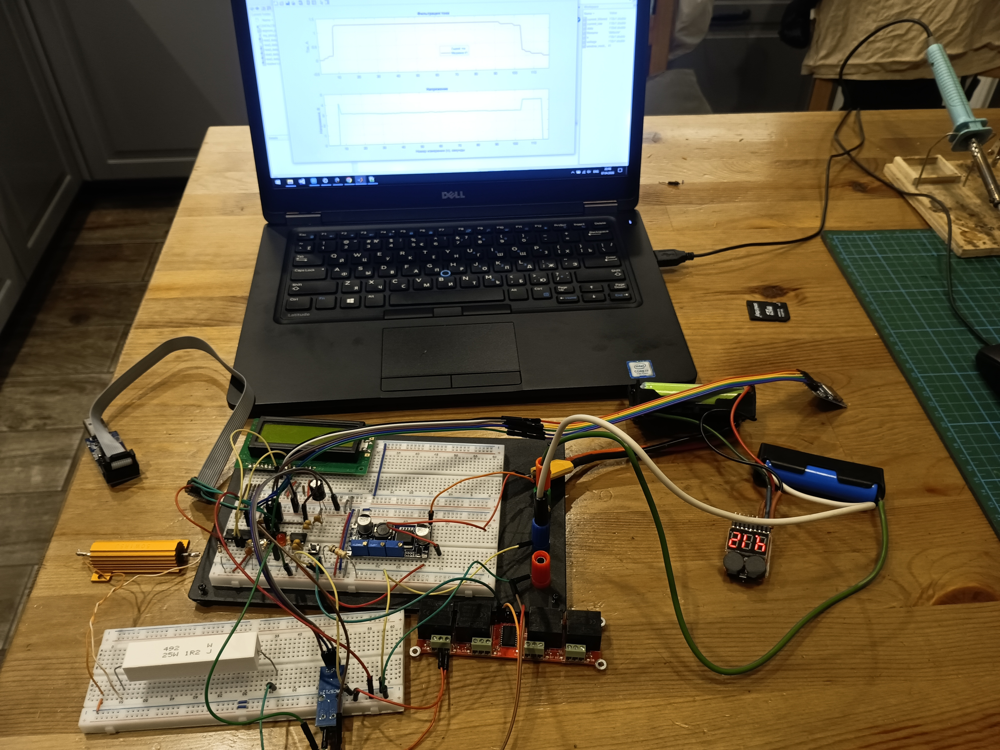
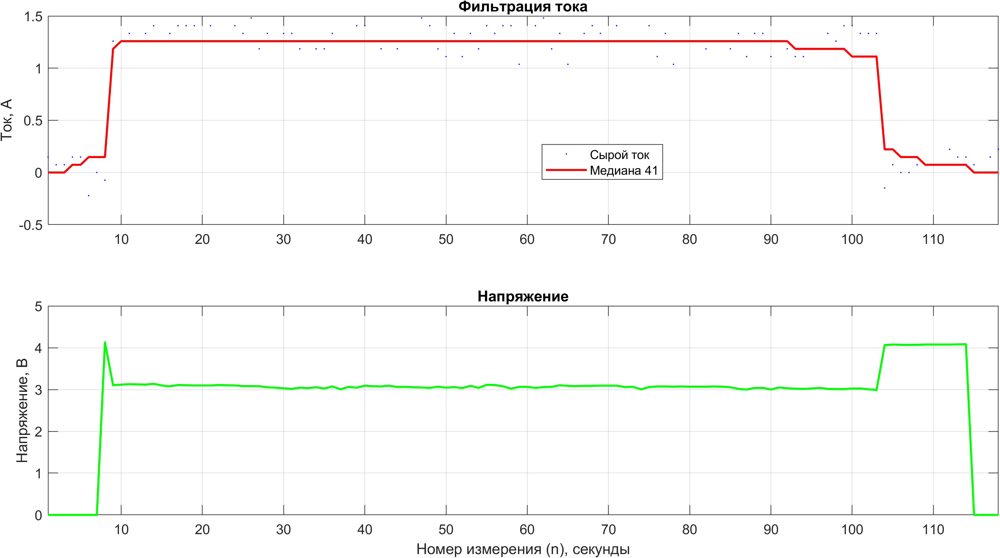

# Лабораторный стенд для параметрического анализа Li-ion аккумуляторов 18650

## Описание проекта

Цель проекта — создание настольного стенда для сбора параметрической информации (ток, напряжение, температура) литий-ионных аккумуляторов типоразмера 18650. Полученные данные предназначены для построения и верификации компьютерных моделей аккумуляторных ячеек.

## Текущая версия стенда

- **Источник питания стенда**: два последовательно соединённых аккумулятора 18650 с зуммером  
- **Преобразователь напряжения**: LM2596 Good Blue Adjustable Step-Down DC-DC Module (вход 4.5…40 В, выход 1.25…37 В, 3 А, 150 кГц)  
- **Микроконтроллер**: ATmega328P  
- **Источник опорного напряжения**: 5 В (REF195GPZ)  
- **Индикация**: LCD дисплей MT16S2H (16×2)  
- **Программатор**: USBasp  
- **Монтаж**: элементы собраны на макетной плате  
- **Датчик тока цепи 18650-нагрузка**: ACS712 30A  
- **Нагрузка 18650**: резистор 25W1R2J (1.2 Ом, 25 Вт)  и резистор 50W1R5J (1.5 Ом, 50 Вт)  
- **Регистрация данных**: MicroSD карта (запись в CSV каждую секунду)  
- **Управление нагрузкой**: автоматическое отключение при падении напряжения ниже 3.0 В, однократное включение при превышении 4.0 В (гистерезис)  
- **Фильтрация тока**: программная (медианный фильтр с окном 41) для устранения импульсных помех  

## Назначение

Стенд позволяет измерять и регистрировать ключевые параметры работы 18650-элемента в различных режимах нагрузки. Полученные CSV-файлы обрабатываются в MATLAB для построения графиков тока, напряжения и расчёта ёмкости. Система обеспечивает защиту от глубокого разряда и однократное включение нагрузки для стандартизации испытаний.

## Фото стенда

## Пример полученных данных

На графике ниже показаны результаты одного из циклов разряда аккумулятора 18650 через резистор 1.2 + 1.5 Ом. Верхний график — отфильтрованный ток (синяя линия) и сырой ток (точки). Нижний график — напряжение на ячейке.

  