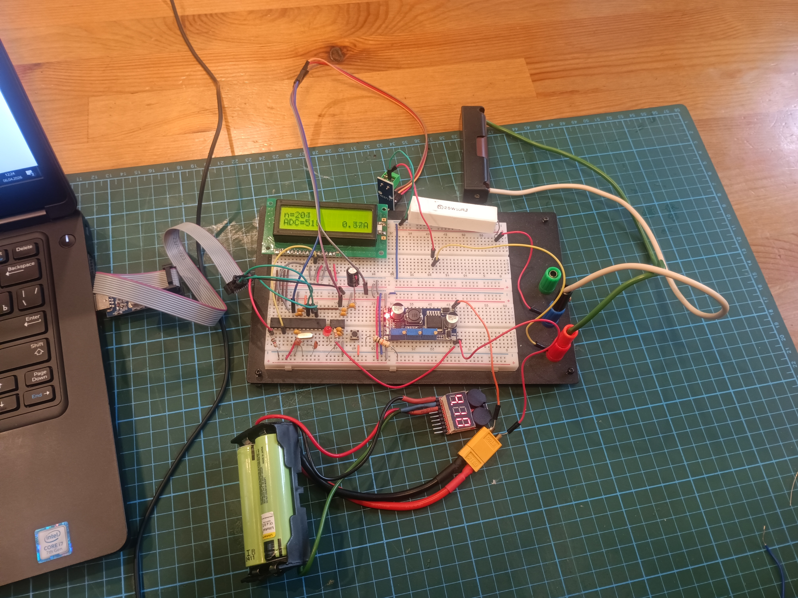

# Лабораторный стенд для параметрического анализа Li-ion аккумуляторов 18650

## Описание проекта

Цель проекта — создание настольного стенда для сбора параметрической информации (ток, напряжение, температура) литий-ионных аккумуляторов типоразмера 18650. Полученные данные предназначены для построения и верификации компьютерных моделей аккумуляторных ячеек.

## Текущая версия стенда

- **Источник питания стенда**: два последовательно соединённых аккумулятора 18650  c зуммером
- **Преобразователь напряжения**: выход 5 В  - LM2596 Good Blue Adjustable Step-Down DC-DC Module, Модуль питания, DC-DC преобразователь, Uвх=4.5…40В, Uвых=1.25…37В, 3А, 150кГц
- **Микроконтроллер**: ATmega328P  
- **Источник опорного напряжения**: 5 В  - REF195GPZ
- **Индикация**: LCD дисплей  - MT16S2H
- **Программатор**: USBasp  
- **Монтаж**: элементы собраны на макетной плате  
- **Датчик тока цепи 18659-нагрузка**:Датчик тока ACS712 30А
- **Нагрузка 18659**: Резистор 25W10RJ

## Назначение

Стенд позволяет измерять и регистрировать ключевые параметры работы 18650-элемента в различных режимах нагрузки, что необходимо для разработки точных компьютерных моделей поведения аккумуляторов.

## Фото стенда

