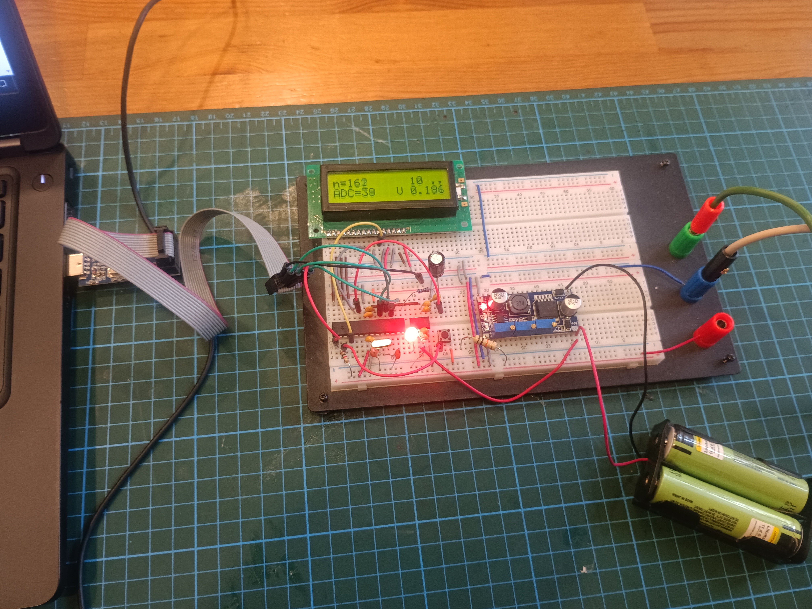

# Лабораторный стенд для параметрического анализа Li-ion аккумуляторов 18650

## Описание проекта

Цель проекта — создание настольного стенда для сбора параметрической информации (ток, напряжение, температура) литий-ионных аккумуляторов типоразмера 18650. Полученные данные предназначены для построения и верификации компьютерных моделей аккумуляторных ячеек.

## Текущая версия стенда

- **Источник питания стенда**: два последовательно соединённых аккумулятора 18650  
- **Преобразователь напряжения**: выход 5 В  
- **Микроконтроллер**: ATmega328P  
- **Источник опорного напряжения**: 5 В  
- **Индикация**: LCD дисплей  
- **Программатор**: USBasp  
- **Монтаж**: элементы собраны на макетной плате  

## Назначение

Стенд позволяет измерять и регистрировать ключевые параметры работы 18650-элемента в различных режимах нагрузки, что необходимо для разработки точных компьютерных моделей поведения аккумуляторов.

## Фото стенда

